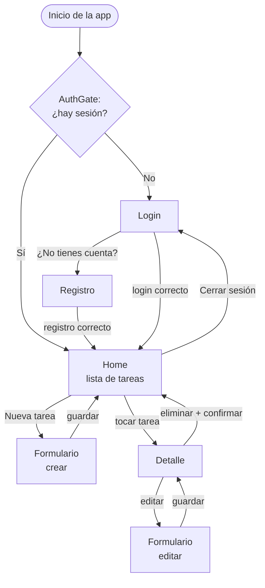

# 02 — Mapa de flujos críticos

## Navegación general

| Ruta | Pantalla | Archivo |
|---|---|---|
| `/` | `AuthGate` → `LoginScreen` o `HomeScreen` | `lib/app.dart` |
| `/registro` | `RegistroScreen` | `lib/screens/registro_screen.dart` |
| `/tarea/formulario` | `TareaFormScreen` (argumento: `Tarea` a editar, o nada para crear) | `lib/screens/tarea_form_screen.dart` |
| `/tarea/detalle` | `TareaDetalleScreen` (argumento: `id` de la tarea) | `lib/screens/tarea_detalle_screen.dart` |

---

## Flujo 1 — Registrarse e iniciar sesión

| Elemento | Detalle |
|---|---|
| Pantallas | Login → Registro → Home |
| Servicio | Firebase Auth: `createUserWithEmailAndPassword`, `signInWithEmailAndPassword`, `authStateChanges` |
| Código | `RegistroScreen`, `LoginScreen`, `AuthGate`, `FirebaseAuthRepository`, `Validators` |
| Datos | Correo, contraseña (mín. 6 caracteres), confirmación de contraseña |

**Pasos**
1. En Login, el usuario pulsa "¿No tienes cuenta? Regístrate".
2. Escribe correo, contraseña y confirmación, y pulsa "Registrarme".
3. Firebase crea la cuenta e inicia sesión; `AuthGate` muestra Home.
4. En una sesión posterior, escribe correo y contraseña en Login y pulsa "Iniciar sesión".

**Puntos de fallo**
- Campos vacíos o con formato inválido: los validadores deben impedir la llamada a Firebase.
- Correo ya registrado (`email-already-in-use`) o credenciales incorrectas (`invalid-credential`).
- Sin red (`network-request-failed`).
- El proveedor email/contraseña no está habilitado en la consola de Firebase (`operation-not-allowed`).

**Casos:** CP-01, CP-02, CP-03, CP-04, CP-18

---

## Flujo 2 — Crear una tarea y verla en la lista

| Elemento | Detalle |
|---|---|
| Pantallas | Home → Formulario (crear) → Home |
| Servicio | Cloud Firestore: `add` en `tareas`; `where('uid', isEqualTo: uid).snapshots()` |
| Código | `HomeScreen`, `TareaFormScreen`, `FirestoreTareaRepository`, `Tarea.toMap/fromMap` |
| Datos | Título (obligatorio), descripción (opcional) |

**Pasos**
1. En Home, el usuario pulsa "Nueva tarea".
2. Escribe el título (y opcionalmente la descripción) y pulsa "Guardar".
3. Se guarda la tarea con el `uid` del usuario y la fecha actual; aparece el SnackBar "Tarea creada".
4. Vuelve a Home y la tarea aparece en la lista sin recargar (stream en tiempo real).

**Puntos de fallo**
- Título vacío o solo con espacios.
- La lista no se actualiza tras crear.
- Doble toque en "Guardar" crea la tarea dos veces (el botón se desactiva mientras guarda).
- Reglas de Firestore rechazan la creación si el `uid` del documento no coincide con el usuario.

**Casos:** CP-05, CP-06, CP-12

---

## Flujo 3 — Ver el detalle y editar o marcar como completada

| Elemento | Detalle |
|---|---|
| Pantallas | Home → Detalle → Formulario (editar) → Detalle |
| Servicio | Cloud Firestore: `get` y `update` sobre `tareas/{id}` |
| Código | `TareaDetalleScreen`, `TareaFormScreen`, `HomeScreen` (checkbox), `FirestoreTareaRepository` |
| Datos | Título, descripción, estado completada |

**Pasos**
1. En Home, el usuario toca una tarea y se abre el Detalle (título, estado, fecha, descripción).
2. Pulsa "Marcar como completada" (o el checkbox en Home); el estado cambia a "Completada".
3. Pulsa el icono de editar, cambia los datos y pulsa "Guardar"; el Detalle se recarga con los cambios.

**Puntos de fallo**
- El Detalle no refleja los cambios tras editar.
- La edición modifica campos que no debe (`uid`, `fechaCreacion`).
- La tarea fue eliminada desde otro dispositivo ("La tarea no existe o fue eliminada").

**Casos:** CP-07, CP-08

---

## Flujo 4 — Eliminar una tarea

| Elemento | Detalle |
|---|---|
| Pantallas | Detalle → diálogo de confirmación → Home |
| Servicio | Cloud Firestore: `delete` sobre `tareas/{id}` |
| Código | `TareaDetalleScreen`, `FirestoreTareaRepository` |

**Pasos**
1. En el Detalle, el usuario pulsa el icono de eliminar.
2. Confirma en el diálogo "Eliminar tarea".
3. Vuelve a Home, aparece el SnackBar "Tarea eliminada" y la tarea ya no está en la lista.

**Puntos de fallo**
- Se elimina sin confirmación, o "Cancelar" elimina igualmente.
- La tarea sigue apareciendo en la lista tras eliminarla.

**Casos:** CP-09

---

## Flujo 5 — Cerrar sesión y que los datos dejen de ser visibles

| Elemento | Detalle |
|---|---|
| Pantallas | Home → Login |
| Servicio | Firebase Auth: `signOut`; reglas de Firestore |
| Código | `HomeScreen`, `AuthGate`, `FirebaseAuthRepository`, `firestore.rules` |

**Pasos**
1. En Home, el usuario pulsa el icono "Cerrar sesión".
2. `AuthGate` detecta el cierre y muestra Login; Home se destruye junto con su suscripción a Firestore.
3. Al iniciar sesión con otro usuario, solo se ven las tareas de ese usuario.

**Puntos de fallo**
- Tras cerrar sesión se puede volver a Home con el botón "Atrás".
- Un segundo usuario ve tareas del primero (filtro por `uid` o reglas incorrectas).

**Casos:** CP-10, CP-11

---

## Matriz de trazabilidad flujo → casos de prueba → pruebas automatizadas

| Flujo | Casos manuales | Pruebas automatizadas relacionadas |
|---|---|---|
| 1. Registro e inicio de sesión | CP-01, CP-02, CP-03, CP-04, CP-18 | `test/unit/validators_test.dart`, `test/widget/login_screen_test.dart`, `test/widget/app_smoke_test.dart` |
| 2. Crear y ver tarea | CP-05, CP-06, CP-12 | `test/widget/tarea_form_screen_test.dart`, `test/widget/home_screen_test.dart`, `test/unit/tarea_model_test.dart` |
| 3. Detalle, editar, completar | CP-07, CP-08 | `test/widget/tarea_form_screen_test.dart` (edición), `test/widget/app_smoke_test.dart` |
| 4. Eliminar | CP-09 | `test/widget/app_smoke_test.dart` |
| 5. Cerrar sesión | CP-10, CP-11 | `test/widget/home_screen_test.dart`, `test/widget/app_smoke_test.dart` |
| Transversal (calidad) | CP-19, CP-20 | `flutter test`, `flutter analyze` |
